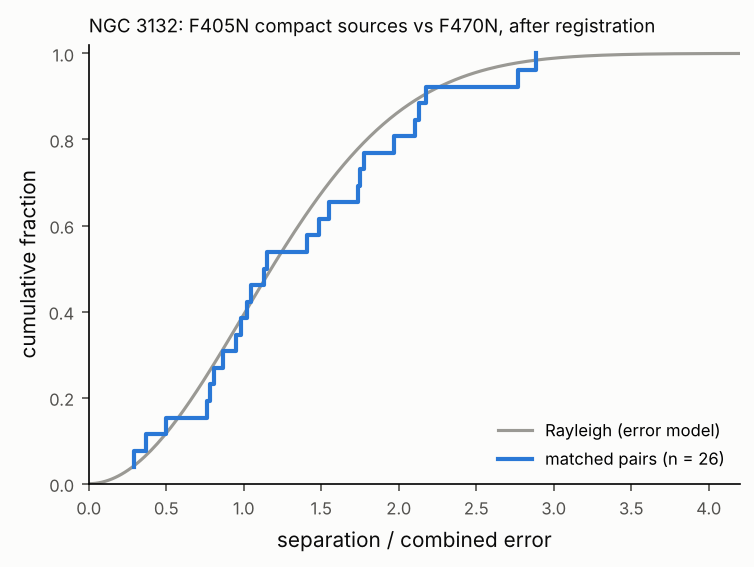

# NGC 3132: F405N × F470N cross-match (roadmap task 17)

This is a real-data check of `astroledger.crossmatch.crossmatch`. It matches the compact sources
detected in the NIRCam F405N mosaic against all detections in the F470N mosaic of JWST program 2733.
Both inputs are rows 480–1880 of the public Stage-3 mosaics.

## Setup

- **A, F405N.** 106 compact sources: FWHM < 3.5 px, S/N > 20, not flagged as near a bright
  source. Each positional error is FWHM / (2.35 S/N), the approximation from roadmap §14.4.
- **B, F470N.** 1,421 detections. This cutout has no ERR extension, so S/N is unavailable. A
  uniform 11 mas error is used instead: the robust scatter of F470N detections against Gaia DR3,
  measured in task 14.
- **Settings.** k = 4. Registration removes the offset between the two mosaics. Local density is
  measured in an annulus.

## Results

**L1 measurements:**

| Quantity | Value |
|----------|-------|
| Frame offset, F405N minus F470N (registration, 39 pairs) | ΔRA·cos Dec = +12.0, ΔDec = +27.2, ± 3.3 mas |
| Calibrated systematic term | 7.2 mas |
| Matched compact F405N sources | 26 of 106 |
| Separation / error, KS test against Rayleigh | D = 0.126, p = 0.76 |
| Conflicts (several candidates or a shared counterpart) | 0 |
| Chance-coincidence probability above 1% | 0 |

## Checks

- **Error model.** Once the frame offset is removed, the matched separations follow the
  distribution the error model predicts (KS p = 0.76).
- **Frame offset.** The registration offset agrees, at about 2σ, with the difference of the two
  mosaics' offsets from Gaia DR3 measured independently in task 14: (+5.3, +22.2) mas.
- **What testing changed.** Without registration (the offset treated as extra random error), and
  without clipping inside the registration, the separations did not follow the model. Both steps
  were added to the engine because of this test.

## Why most compact F405N sources have no F470N match (L2)

- Many compact F405N sources are knots of Brackett-α (ionised hydrogen) emission. F470N traces
  molecular hydrogen (H₂), so these knots need not appear in it.
- Of the 31 F405N sources that coincide with Gaia stars, several bright ones have no F470N
  detection within 0.4–2.5″. This is consistent with saturated, masked cores in F470N: a
  detection limitation, not a matching one.

## Not done here

No identities are assigned: a match is a positional coincidence (L1). Identification belongs to
the CDS adapters (task 16, blocked here by the network policy) and the evidence engine (task 18).

## Files

- `*_best.ecsv`: one row per F405N source.
- `*_candidates.ecsv`: every pair inside its radius.
- `*_conflicts.ecsv`: the conflicts table.
- `*.prov.json`: provenance records.

Reproduce with `python examples/ngc3132_crossmatch.py --cache data/ngc3132`.
